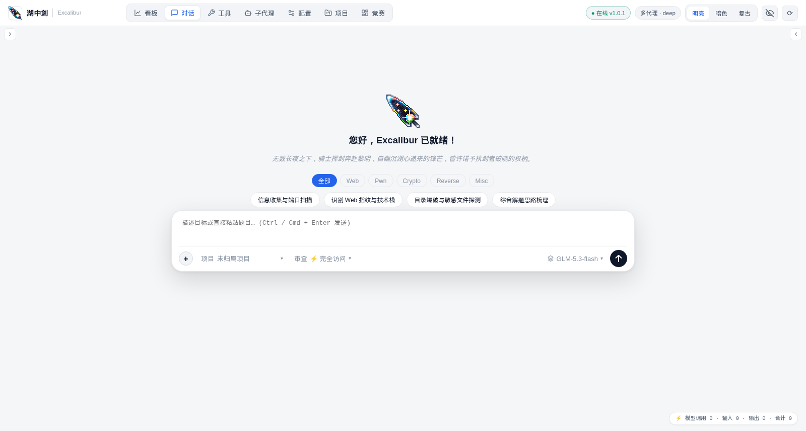
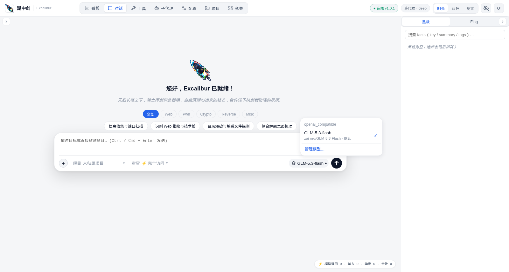
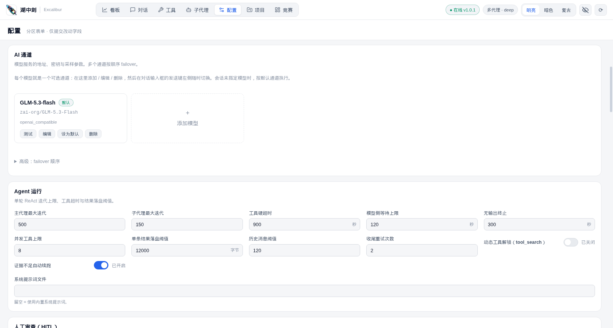

<div align="center">


# 湖中剑 · Excalibur

**AI 原生 CTF 自主解题智能体平台**

<p>
  
  
  
  
  
</p>
<p>
  
  
  
  
  
  
</p>
<p>
  
  
  
  
  
</p>

理题、侦察、分析、利用、提取、复盘，全流程自动闭环。

*无数长夜之下，骑士挥剑奔赴黎明，自幽沉湖心递来的锋芒，曾许诺予执剑者破晓的权柄。*

</div>

---

## 📖 项目简介

**Excalibur（湖中剑）** 是一个用 Python 构建的 CTF 自主解题智能体平台。输入题目描述与附件，代理会自主完成
**理题 → 侦察 → 分析 → 利用尝试 → Flag 提取 → 解题报告** 的完整闭环。

它不是"给模型套一层工具调用"的壳，而是一套围绕 LLM 搭建的**控制系统**：外置调度回路、状态账本、
渲染式上下文、双阶段收尾、多模式人工审查、全链路事件流——让模型专注做它擅长的事：理解状态、决定下一步。

---

## ✨ 核心特性

| 能力 | 说明 |
|---|---|
| 🧠 **ReAct 自主解题** | 单轮迭代上限可配（默认 500），工具超时、无输出终止、并发上限均可调 |
| 🕸️ **多代理编排** | 单代理 / 多代理（deep）双模式；按 Web、Pwn、Crypto、Reverse、Misc、Recon 方向派发子代理 |
| 📒 **状态账本 + 黑板** | Idea / Memory 双账本沉淀结论，黑板跨会话共享事实与协议接口 |
| 🛡️ **三模式 HITL 审查** | 完全访问 / 白名单 / 逐步确认，命令执行前拦截，超时 fail-closed |
| 🔀 **模型管理** | 多通道增删改、连通性探测、发送键旁随时切换，选择按会话持久化 |
| 🏆 **竞赛模式** | 同时支持 Arena 单题制（current / next / submit）与列表式平台的题目池同步 |
| 📊 **数据看板** | Flag 捕获、工具调用、趋势与分类分布，按项目维度聚合 |
| 🕶️ **极简隐藏模式** | 独立窗口的轻量对话界面，含编解码工具箱伪装面 |
| 🧹 **文本安全** | 孤立代理字符清洗（四道闸门），避免脏文件名导致模型调用崩溃 |

---

## 📸 界面预览

<table>
  <tr>
    <td width="50%">
      
      <br /><sub><b>对话界面</b>：题目分类快捷入口、项目 / 审查模式 / 模型一键切换</sub>
    </td>
    <td width="50%">
      
      <br /><sub><b>模型选择</b>：发送键旁切换通道，选择按会话持久化</sub>
    </td>
  </tr>
</table>


<p align="center"><sub><b>配置页</b>：模型卡片化管理（测试 / 编辑 / 设为默认 / 删除），参数分区表单</sub></p>

---

## 🚀 快速开始

### 环境要求

- **Python ≥ 3.11**
- 可选：Docker（容器化部署）、Kali 工具链（nmap / ffuf / gdb / binwalk 等，按需安装，缺失的工具会被自动跳过）

### 1. 获取代码

```bash
git clone https://github.com/KornZebra/Excalibur.git
cd Excalibur
```

### 2. 一键启动（推荐）

```bash
python3 run.py
```

脚本会自动完成：创建 `.venv` → 安装依赖 → 生成 `config.yaml` → 启动 Web 服务。

### 3. 填写模型密钥

编辑 `config.yaml`，填入任意 OpenAI 兼容服务商的密钥：

```yaml
ai:
  default_channel: main
  channels:
    main:
      name: GLM-5.3-flash
      provider: openai_compatible
      base_url: https://api.siliconflow.cn/v1
      api_key: "sk-REPLACE_WITH_YOUR_KEY"   # ← 换成你自己的 Key
      model: zai-org/GLM-5.3-Flash
```

> 也可以启动后进入「配置 → AI 通道」用界面添加 / 编辑模型，无需改文件。

### 4. 访问

浏览器打开 **http://127.0.0.1:8080**，新建会话，粘贴题目描述或拖入附件即可开始。

### run.py 参数说明

```bash
python3 run.py                          # 默认启动：0.0.0.0:8080
python3 run.py --host 127.0.0.1         # 只监听本机，不暴露到局域网
python3 run.py --port 8081              # 换端口（端口冲突时常用）
python3 run.py --skip-install           # 跳过依赖安装，启动更快
python3 run.py --extras "mcp,vision"    # 额外安装可选依赖组
python3 run.py --cli "题目描述"          # CLI 模式，不起 Web 服务
```

| 参数 | 作用 | 默认值 |
|---|---|---|
| `--host` | 监听地址；`127.0.0.1` 仅本机可访问，`0.0.0.0` 允许局域网访问 | 取 `config.yaml` 的 `server.host` |
| `--port` | 监听端口 | 取 `config.yaml` 的 `server.port`（8080） |
| `--skip-install` | 跳过 `pip install -e .`，适合依赖已就绪的场景 | 关闭（会安装） |
| `--extras` | 可选依赖组，逗号分隔：`mcp`（外部 MCP 工具）、`knowledge`（向量检索）、`vision`（图像输入） | 空 |
| `--cli` | 以命令行模式运行，其后参数原样透传给 CLI | — |

### 手动安装（可选）

```bash
python3 -m venv .venv && source .venv/bin/activate   # Windows: .venv\Scripts\activate
pip install -e .                # 可选 extras：.[mcp,knowledge,vision]
cp config.example.yaml config.yaml
python3 -m ctfagent.server --port 8080
```

### Docker 方式（可选）

```bash
docker compose -f docker-compose.dev.yml up -d
```

---

## 📁 目录结构

```
Excalibur/
├── ctfagent/               # 后端核心：Agent 内核、API、存储、工具系统、竞赛引擎
│   ├── agent/              #   ReAct 循环、调度器、上下文渲染、终止判定
│   ├── api/                #   FastAPI 路由（对话 / 配置 / 模型 / 看板 / 竞赛）
│   ├── storage/            #   SQLite 仓储层与迁移
│   ├── tools/              #   工具注册与执行治理
│   └── competition/        #   竞赛模式（文档解析、协议适配、引擎）
├── web/                    # 前端（原生 JS，无构建链）
├── agents/                 # 子代理角色定义（web / pwn / crypto / reverse / misc / recon）
├── tools/                  # 工具描述（YAML）
├── skills/                 # 技能包
├── tests/                  # 测试用例
├── docker/                 # 容器化与练习靶场
├── docs/                   # 文档资源（logo、截图）
├── config.example.yaml     # 配置模板（全字段注释）
├── challenges_export.json  # 题目定义快照（示例数据）
└── run.py                  # 一键启动脚本
```

---

## ⚙️ 关键配置

| 配置段 | 作用 | 常用项 |
|---|---|---|
| `server` | 服务监听 | `host` / `port` |
| `ai` | 模型通道 | `default_channel` / `channels.*.api_key` / `base_url` / `model` |
| `agent` | 运行上限 | `max_iterations` / `tool_timeout_seconds` / `max_concurrent_tools` |
| `hitl` | 人工审查 | `enabled` / `default_reviewer` / `tool_whitelist` |

完整字段见 [`config.example.yaml`](config.example.yaml)。

---

## ⚖️ 合规声明

- 本项目**仅用于 CTF 竞赛环境、自建靶场（本地 Docker / VM）或获得明确书面授权的目标**。
- 系统提示词内置目标范围校验：未提供合法题目目标时，代理会拒绝行动并要求补充信息。
- 项目不包含、也不应被改造用于：针对真实第三方目标的攻击编排、C2、WebShell 持久化控制等场景。
- 使用本项目即表示你理解并同意：对任何无授权使用承担全部责任。

---

## 🙏 参考与致谢

本项目的部分设计思路与交互形态参考了以下开源项目，在此致谢：

| 项目 | 参考内容 |
|---|---|
| [deepseek-ai/deepseek-harness](https://github.com/deepseek-ai/deepseek-harness) | 前端交互：对话轮次导航轨（TurnNavigator）的固定节距梯子与指针命中模型、模型选择器（ModelSelect）的布局与交互 |
| [AIPentest/CyberStrikeAI](https://github.com/AIPentest/CyberStrikeAI) | 前端交互：对话轮次指示条的形态设计 |
| [oritera/Cairn](https://github.com/oritera/Cairn) | 架构设计：以 Fact / Intent / Hint 三原语建模状态空间搜索、Dispatcher 单进程调度与并发限流、上下文外置等思路 |

以上项目的代码版权归各自作者所有，分别遵循 MIT、Apache-2.0、AGPL-3.0 许可证；
本项目仅借鉴其设计思路，并在自身技术栈（Python + 原生 JavaScript）上独立实现。

README 徽章样式参考 [Badges4-README.md-Profile](https://github.com/alexandresanlim/Badges4-README.md-Profile)。

---

## 📄 许可证

本项目基于 [MIT License](LICENSE) 开源。
